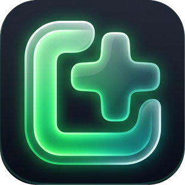
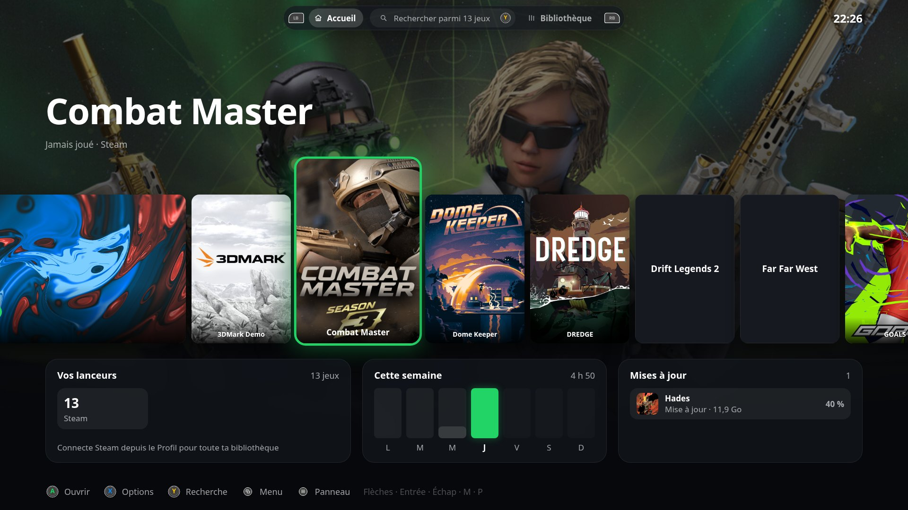
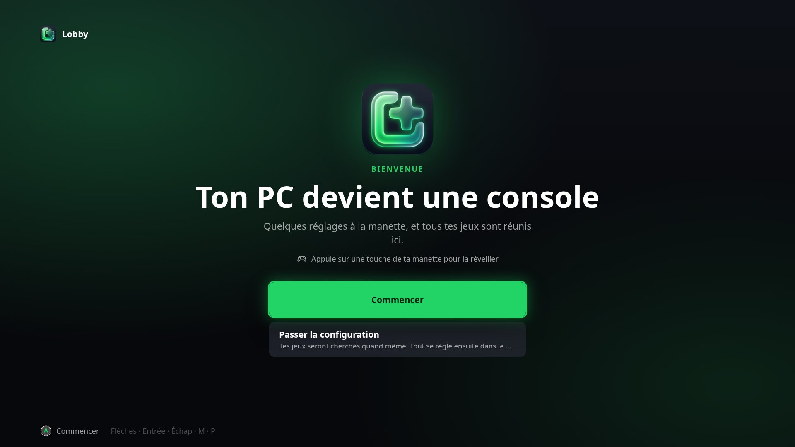
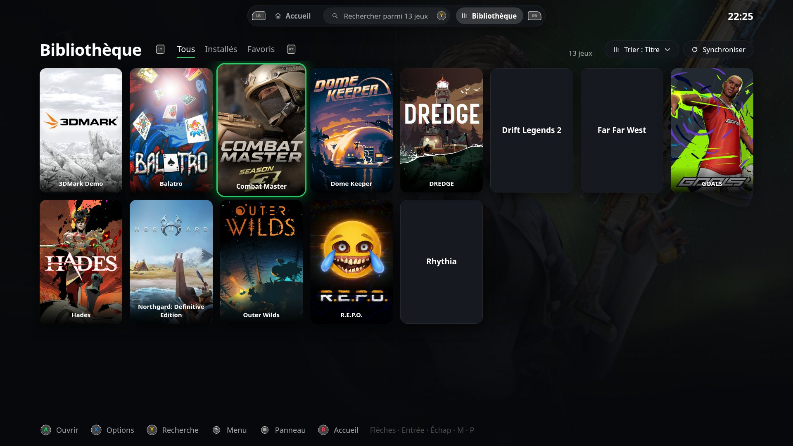
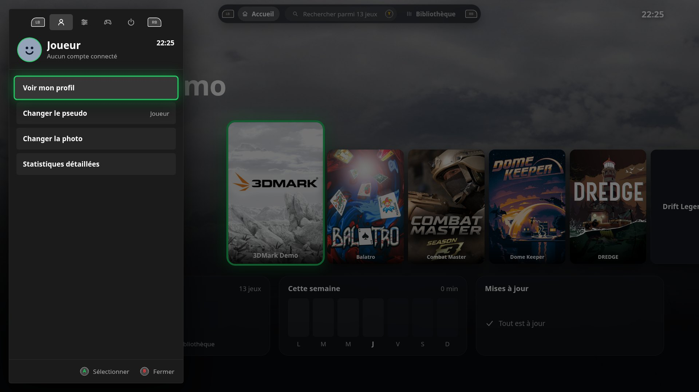
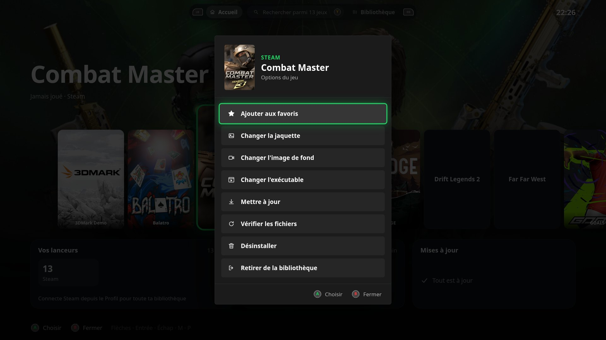
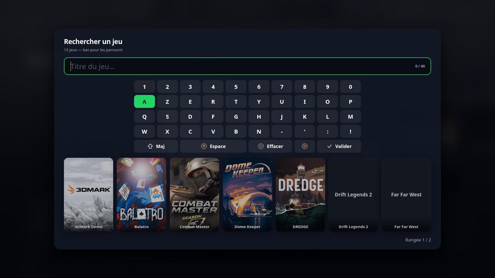
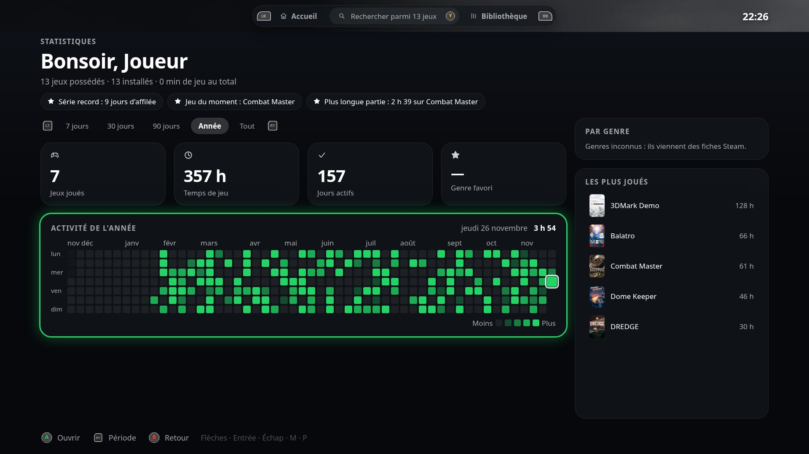

<p align="center">
  
</p>

<h1 align="center">Lobby</h1>

<p align="center">
  Transforme ton PC en console de jeux.<br>
  Tous tes jeux Steam et Epic au même endroit, sur ta TV, et tout se fait à la manette.<br>
  Fonctionne sur Windows et Linux.
</p>

<p align="center">
  <a href="https://github.com/TISEPSE/Lobby/releases/latest"></a>
  <a href="https://github.com/TISEPSE/Lobby/actions/workflows/release.yml"></a>
</p>

## Captures d'écran

<p align="center">
  
</p>

Au premier lancement, tout se configure à la manette, puis tes jeux sont réunis dans la bibliothèque :

<p align="center">
  
  
</p>

| | |
|:---:|:---:|
|  |  |
| Menu rapide | Options d'un jeu |
|  |  |
| Recherche au clavier virtuel | Statistiques de jeu |

Les captures montrent une bibliothèque et des statistiques de démonstration.

## Télécharger

Prends la dernière version pour ton système sur la
[page des releases](https://github.com/TISEPSE/Lobby/releases/latest).

| Système | Formats |
|---------|---------|
| Windows | `.exe` (x64) |
| Linux | `.deb`, `.AppImage` |

L'installeur n'est pas signé : Windows peut afficher un avertissement
SmartScreen au premier lancement.

## Fonctionnalités

- **Navigation 100 % manette** : croix ou stick, A valider, B retour, X options,
  Y recherche. Glyphes Xbox ou PlayStation selon la manette branchée
- **Détection des jeux** : Steam, Epic Games, raccourcis du Bureau et tes propres
  dossiers, sur tous les disques
- **Comptes Steam et Epic** : toute ta bibliothèque, même les jeux non installés,
  avec ton temps de jeu. Connexion par la page officielle, sans clé d'API
- **Accueil vivant** : reprendre le dernier jeu en un appui, temps de jeu de la
  semaine, mises à jour Steam en cours
- **Fiche de chaque jeu** : résumé, note, captures et bandes-annonces
- **Lancement propre** : un écran de chargement cache le bureau, Lobby se met de
  côté pendant la partie et revient quand elle se termine
- **Menu en jeu** (View + Menu maintenus) pour revenir à Lobby ou quitter le jeu
- **Statistiques** : calendrier d'activité, jeux les plus joués, séries record
- **Jaquettes au choix** : Steam, Lutris ou SteamGridDB, pour la tuile comme pour
  le fond
- Menu rapide, recherche au clavier virtuel, écran de veille, sons d'interface
  réglables
- Lancement au démarrage de Windows, ou session Linux dédiée façon Steam Deck
  (Gamescope + systemd, voir [`system/`](system/))

Côté vie privée : Lobby ne contient aucune clé d'API. Les sessions Steam et Epic
sont chiffrées sur le disque, et la seule clé facultative (SteamGridDB) reste
dans tes réglages.

## Développement

Lobby est construit avec Tauri 2 (Rust + Svelte 5 + TypeScript).

### Prérequis

- Node.js 22 ou plus
- Rust (stable)
- Les dépendances système de Tauri ([voir la doc Tauri](https://v2.tauri.app/start/prerequisites/))

### Démarrer

```bash
git clone https://github.com/TISEPSE/Lobby.git
cd Lobby
npm install
npm run tauri dev
```

### Dans le navigateur

```bash
npm run dev              # http://localhost:5177
```

L'interface tourne dans le navigateur avec une bibliothèque de démonstration,
sans backend Rust. Des paramètres d'adresse ouvrent directement un écran, ce qui
sert aux captures :

```bash
google-chrome --headless=new --window-size=1920,1080 --virtual-time-budget=12000 \
  --screenshot=out.png "http://localhost:5177/?nopad&screen=library"
```

### Commandes utiles

```bash
npm run tauri dev                          # lancer l'application
npx svelte-check --threshold error         # vérifier les composants
npx tsc --noEmit -p tsconfig.app.json      # vérifier les fichiers .ts
npm run tauri build                        # construire l'installeur
```

Pour publier une version, pousser un tag `vX.Y.Z` : GitHub compile l'installeur
Windows et les paquets Linux, puis les publie dans une release.

## Limites connues

- Interface en français seulement
- Pas de version macOS
- Manettes en mapping « standard » seulement
